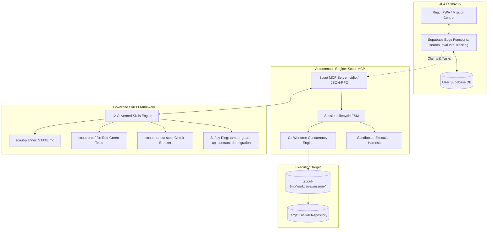

# Scout V2 Architecture & Autonomous Engine Specification

This document serves as the master architectural specification for **Open Source Scout V2**.

---

## 1. System Architecture Map

---

## 2. Core Documentation Index

To explore the detailed design, token economics, and implementation specifications:

1. **[Why Scout V2: The Paradigm Shift](docs/01_overview/WHY_SCOUT_V2.md)**
   - Explains the evolution from V1 ("Scout, don't code") to V2 (Autonomous Verified Contributor).
2. **[Token Economics & Active Retrieval via MCP](docs/02_mcp_and_token_economics/TOKEN_ECONOMICS_AND_RETRIEVAL.md)**
   - Detailed breakdown of how on-demand tool inspection cuts token consumption by 90% and eliminates context stuffing hallucinations.
3. **[The 12 Governed Skills Framework](docs/03_the_12_core_skills/SKILLS_MANIFEST_AND_FLOW.md)**
   - Complete reference manual for all 12 skills in `.scout/skills/` spanning Orchestration, Safety Guards, Verification, and Circuit Breakers.
4. **[The Triangle Defense (Planner, Proof-of-Fix, Honest Stop)](docs/03_the_12_core_skills/THE_TRIANGLE_DEFENSE.md)**
   - The three core pillars that prevent blind edits, hallucinated fixes, and runaway token loops.
5. **[Developer Explainer & Verbal Scripts](docs/04_developer_explainer/ELEVATOR_PITCH_AND_FAQ.md)**
   - Ready-to-use verbal scripts and answers for technical discussions, interviews, and presentations.
6. **[Scout MCP Technical Specification](docs/mcp/SPECIFICATION.md)**
   - Complete JSON-RPC tool schemas, worktree lifecycle, and finite state machine definitions.
