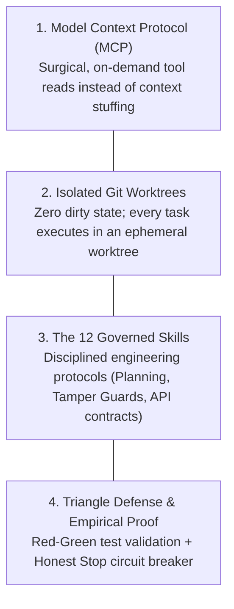

# Why Scout V2: The Autonomous Contributor Paradigm

## 1. Executive Summary

**Open Source Scout V1** was designed around the philosophy: _"Scout, don't code."_ It operated as an intelligent issue discovery engine and automated engagement scraper, helping developers find relevant issues and claim them via GitHub comments. However, **the human was still expected to write 100% of the code, manage git branches, write tests, and create PRs.**

**Open Source Scout V2** represents a generational leap: **Autonomous Contribution with Governed Verification**.

V2 transforms Scout from a passive notification tool into an active, disciplined software engineering agent capable of taking a GitHub issue, creating an isolated git worktree, formulating a verified plan, surgically patching code via MCP, proving the fix with unit tests, and opening a clean pull request.

---

## 2. Why V1 Hit a Wall

In V1:

1. **The Human Bottleneck:** Developers found great issues, but still had to clone repos, configure dependencies, understand complex architectures, and write code from scratch. Most claimed issues sat idle.
2. **Naive AI Agents Failed:** When developers tried using standard generative AI scripts (or naive chat prompts) to write code:
   - The LLM hallucinated non-existent files and functions.
   - It dumped huge blocks of modified code that overwrote unrelated logic.
   - It hallucinated that "everything is working" without executing a single test.
   - It burned \$2.00–\$5.00 in token costs per run by feeding entire codebases into the prompt.

---

## 3. The Core Principles of Scout V2

Scout V2 solves these fundamental failures through **Four Architectural Pillars**:

### Pillar 1: Surgical Context via MCP (Zero Context Stuffing)

Instead of feeding 100,000 tokens of source code to an LLM upfront, Scout MCP launches the agent with **only 1,500 tokens** (the issue text + tool declarations). The agent uses tools (`read_file`, `run_command`) to dynamically discover and read _only_ the specific 40 lines of code it needs. Token burn drops by 85–90%, and hallucinations vanish.

### Pillar 2: Ephemeral Git Worktree Isolation

Agents never work on `main` or the host's active working directory. Every task spins up an isolated worktree at `.scout-tmp/worktrees/session-<id>`. If an agent breaks anything or fails, the worktree is nuked with zero damage to the host repository.

### Pillar 3: Governed Engineering Skills

An LLM left to its own devices behaves erratically. Scout V2 enforces 12 strict protocols (defined in `.scout/skills/`):

- Before coding: write an explicit architectural plan (`scout-planner`).
- During coding: restrict edits to target files only (`scout-tamper-guard`).
- When changing schema: ensure backward-compatible migrations (`scout-db-migration`).

### Pillar 4: Empirical Proof of Fix & Honest Stop

- **Proof-of-Fix:** An agent is never allowed to say "I fixed it." It must write a reproduction test that **fails before the fix** (Red) and **passes after the fix** (Green).
- **Honest Stop:** If an agent encounters missing environment secrets, contradictory requirements, or fails tests 3 times, it halts immediately, marks the task `BLOCKED`, and saves token budget.

---

## 4. Architectural Evolution Matrix

| Feature                 | Open Source Scout V1                 | Open Source Scout V2                                          |
| :---------------------- | :----------------------------------- | :------------------------------------------------------------ |
| **Mission**             | "Scout, don't code" (Discovery only) | Autonomous End-to-End Contributor                             |
| **Interface**           | React Web Dashboard                  | Web Dashboard + Scout MCP Server                              |
| **Code Implementation** | Manual by Human                      | Autonomous by Agent (Guarded by Skills)                       |
| **Context Strategy**    | Web search / Issue payloads          | Dynamic On-Demand Retrieval via MCP                           |
| **Git Safety**          | N/A (Human manages Git)              | Ephemeral Git Worktrees (`git worktree`)                      |
| **Verification**        | Human manual testing                 | Automated Red-Green Test Reproduction (`scout-proof-fix`)     |
| **Failure Mode**        | Abandoned issue                      | `scout-honest-stop` circuit breaker + detailed blocker triage |
| **Token Cost / Task**   | Minimal (Scoring only)               | ~$0.08–$0.25 (90% lower than naive agents)                    |
