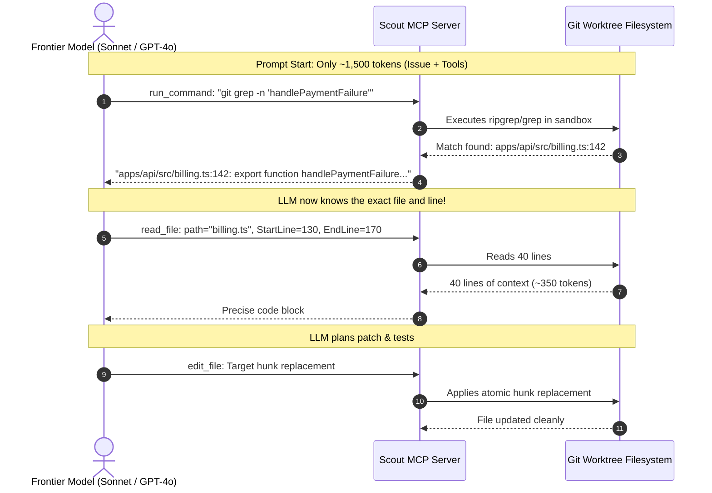

# Token Economics & Active Retrieval: How Scout V2 Understands Code Without Burning Tokens

## 1. The Core Question

> _"If you don't load the entire codebase into the LLM's context window, how does the model understand where the bug is and how to fix it? Don't you have to burn all your tokens anyway?"_

This is the most common misunderstanding developers and engineering managers have about AI coding agents.

The answer is: **No. Scout V2 treats the LLM like a human software engineer, not a database.**

---

## 2. The Context Stuffing Fallacy (The Naive Way)

Traditional AI tools and naive scripts use **Context Stuffing**:

```
[Issue Description]
+ [File 1: 800 lines]
+ [File 2: 1200 lines]
+ [File 3: 450 lines]
...
+ [File 30: 2500 lines]
=============================
Total Prompt: 120,000 Tokens!
Cost: ~$1.20 per prompt turn
```

### Why Context Stuffing Fails:

1. **The "Lost in the Middle" Degradation:** Large Language Models suffer from attention decay when context exceeds 30k–50k tokens. They forget edge conditions and miss key variable definitions buried in the middle of massive files.
2. **Hallucination Amplification:** When overwhelmed with irrelevant code, models confuse similarly named functions, hallucinate non-existent arguments, and overwrite working code.
3. **Astronomical Token Costs:** Every iterative step re-sends the entire 120,000-token payload. A single bug fix requiring 5 back-and-forth steps burns **600,000+ tokens (\$3.00–\$6.00)**.

---

## 3. The Scout V2 Active Retrieval Pattern

Human engineers never read 500,000 lines of code before fixing a bug.
Instead, a senior engineer follows this mental model:

1. Read the issue report and identify keywords or error traces.
2. Use terminal search (`grep`, `find`, or symbol search) to locate the suspect file.
3. Open only the suspect file and inspect the 30 lines surrounding the target function.
4. Check the type definitions of the incoming parameters.
5. Write a failing test, patch the 5 lines, and run the test suite.

**Scout MCP empowers the LLM to follow this exact human workflow.**



---

## 4. Token Math Comparison: Real-World Case Study

Consider fixing a bug in an open-source TypeScript repository with 45,000 lines of code across 120 files:

| Metric                     | Naive Context Stuffing             | Scout V2 Active Retrieval (MCP)             | Savings            |
| :------------------------- | :--------------------------------- | :------------------------------------------ | :----------------- |
| **Initial Turn Input**     | 85,000 tokens                      | **1,450 tokens**                            | **98.3% less**     |
| **Investigation Phase**    | 85,000 tokens / turn               | **600 tokens** (via `run_command` grep)     | **99.3% less**     |
| **Code Inspection**        | Re-sends full files                | **850 tokens** (via byte-range `read_file`) | **99.0% less**     |
| **Edit Phase**             | Full file overwrite (4,000 tokens) | **320 tokens** (Target hunk replacement)    | **92.0% less**     |
| **5-Turn Lifecycle Total** | **450,000 tokens (~$3.60)**        | **~~14,200 tokens (~~$0.11)**               | **~96.8% Savings** |

---

## 5. Surgical Tools Provided by Scout MCP

The Scout MCP server exposes specialized, bounded tools that keep token usage minimal:

1. **`read_file` (Bounded Byte Ranges):** Supports `StartLine` and `EndLine` parameters. The agent reads only the function or interface in question, not entire 3,000-line utility files.
2. **`edit_file` (Hunk Replacement):** Uses strict string replacement (`Target` ➔ `Replacement`). The model only outputs the exact 5–10 lines being modified, rather than generating the whole file from scratch (which saves output tokens, the most expensive token tier).
3. **`run_command` (Filtered Shell Execution):** Allows running `git grep`, `npm test`, or compiler type checks with truncated outputs to prevent terminal buffer overflows.
4. **`initialize_execution`:** Creates an isolated worktree branch in `.scout-tmp/worktrees/` ensuring all file inspections and patches are strictly isolated from the parent repository.
