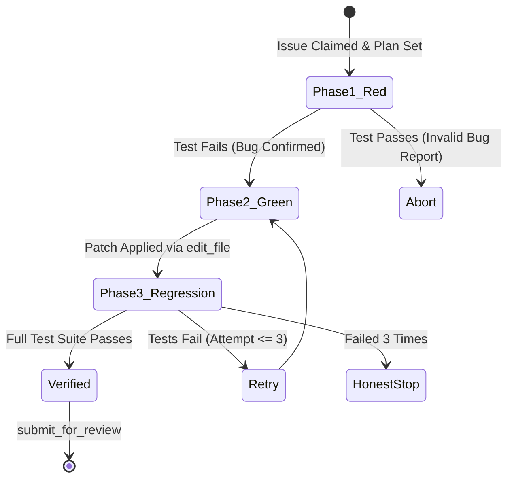

# The Triangle Defense: Planner, Proof-of-Fix, and Honest Stop

## 1. Introduction

Most autonomous AI agents suffer from three fatal flaws when applied to real-world codebases:

1. **Blind Hacking:** The agent immediately starts editing code without understanding the architectural blast radius.
2. **False Triumphs (Hallucinated Fixes):** The agent says _"I fixed the issue and cleaned up the code!"_, but the test suite fails and the code doesn't even compile.
3. **Runaway Token Burn:** When stuck on an error, the agent enters an infinite loop, trying random changes until it depletes the user's API balance.

Scout V2 solves these three flaws with **The Triangle Defense**:

```text
                     ▲
             [ scout-planner ]
             (Architectural Blueprint)
                   /   \
                  /     \
                 /       \
                /         \
               ▼           ▼
      [ scout-proof-fix ] ◀───▶ [ scout-honest-stop ]
      (Empirical Verification)       (Autonomous Circuit Breaker)
```

---

## 2. Pillar 1: Scout Planner (The Architectural Blueprint)

Before an agent touches a single character of code, `scout-planner` forces it to create a structured `STATE.md` document.

### The Planner Checklist:

1. **Scope Boundary:** List the exact files that need to be touched.
2. **Contract Analysis:** Check whether changing this file affects other packages, frontend components, or database tables.
3. **Targeted Discovery:** Use `run_command` with `git grep` and byte-range `read_file` to inspect only the required functions.
4. **Step-by-Step Milestones:** Break the fix into discrete, verifiable actions.

> **Why this matters to you:**
> If a developer asks: _"How do you prevent the AI from breaking other parts of the project?"_
> **Answer:** _"The Planner writes a strict scope boundary into `STATE.md`, and `scout-tamper-guard` mechanically blocks the model from editing any file outside that boundary."_

---

## 3. Pillar 2: Scout Proof-of-Fix (Empirical Verification)

In Scout V2, **an agent is never allowed to claim an issue is resolved without empirical proof.**

Traditional software engineering relies on **Test-Driven Development (TDD)**. Scout V2 enforces this via the **Red-Green-Refactor Protocol**:



### The 3 Mandatory Verification Steps:

1. **Phase 1 (Red):** The agent writes a unit test or script reproducing the bug reported in the GitHub issue. The test **must fail**. If the test passes initially, the bug cannot be reproduced, and the agent stops.
2. **Phase 2 (Green):** The agent applies the minimal, surgical fix using `edit_file`. The reproduction test **must now pass**.
3. **Phase 3 (Regression):** The agent runs the workspace's entire test suite (`npm test`, `pytest`, `cargo test`) to guarantee zero regressions in unrelated modules.

---

## 4. Pillar 3: Scout Honest Stop (The Circuit Breaker)

The most dangerous trait of naive AI models is **overconfidence**. When a model does not know what to do, it guesses. It makes up API endpoints, fabricates environment variables, or simply comments out broken tests to make the build pass.

`scout-honest-stop` is Scout's autonomous circuit breaker.

### When Does Honest Stop Trigger?

- **Missing Secrets or Infrastructure:** The task requires an external API key (e.g. Stripe, AWS) that is not in the sandbox.
- **Ambiguous or Contradictory Specs:** The GitHub issue contradicts the existing codebase or project architecture.
- **The 3-Strike Rule:** If the agent attempts a fix 3 times and tests continue to fail, it is strictly forbidden from trying a 4th time.

### What Happens on an Honest Stop?

1. The agent calls the MCP tool `mark_blocked`.
2. It outputs a structured, actionable diagnostic report:
   ```markdown
   ## 🛑 Scout Honest Stop: Execution Blocked

   - **Reason:** Missing Third-Party Credential
   - **File Inspected:** `apps/api/src/integrations/stripe.ts`
   - **Blocked Action:** Cannot verify payment webhook signature without `STRIPE_WEBHOOK_SECRET`.
   - **Action Required by Human:** Provide `STRIPE_WEBHOOK_SECRET` in the workspace environment or mock the webhook signature in tests.
   ```
3. The isolated Git worktree is preserved in `.scout-tmp/worktrees/` so the human developer can inspect the exact point of failure.
4. **Token burn stops immediately.** The user is not billed for futile guessing loops.
