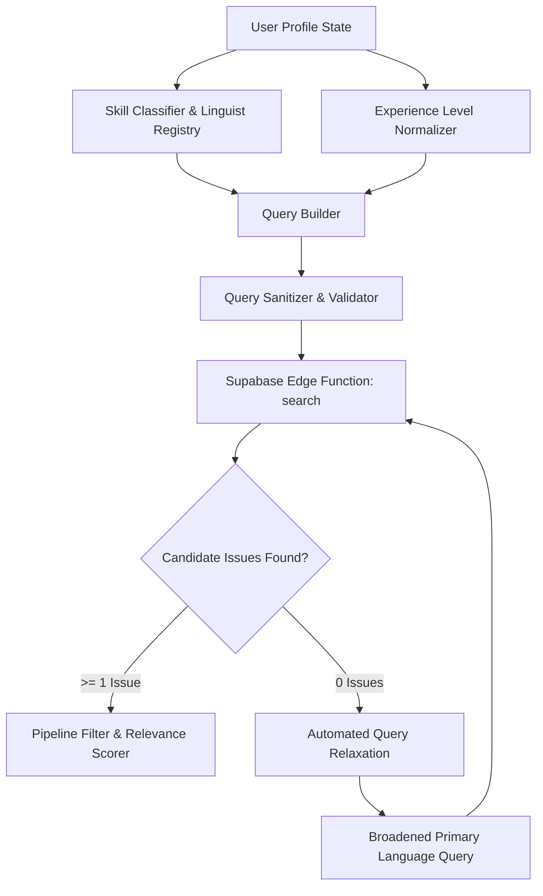

# Architecture Guide: GitHub Dynamic Query & Discovery Engine

## 1. System Overview

The Open Source Scout **GitHub Query & Discovery Engine** transforms unstructured developer skill arrays and experience tiers into high-precision, syntactically valid GitHub Search API queries.

By decoupling language identification, framework-to-topic translation, and tier-specific label scoping, the engine ensures candidate issues directly match a developer's real capabilities while respecting strict GitHub API limitations.

---

## 2. GitHub Search API Ground-Truth Constraints

| Constraint              | Limit                                         | Engine Mitigation                                                                                           |
| :---------------------- | :-------------------------------------------- | :---------------------------------------------------------------------------------------------------------- |
| **Max Query Length**    | 256 characters                                | `sanitizeGitHubQuery` automatically trims redundant whitespace and prunes secondary qualifiers.             |
| **Qualifier Limit**     | 5 language qualifiers                         | `limitLanguages` limits language qualifiers to top 3 (max 5) to prevent HTTP 422 errors.                    |
| **Rate Limit**          | 30 requests / min (Search API)                | Caching via `sessionStorage` and automated polling throttling.                                              |
| **Language Names**      | Must match Linguist canonical names           | `isLinguistLanguage` and `normalizeLinguistLanguage` validate identifiers before generating `language:XXX`. |
| **Non-Language Skills** | Frameworks in `language:` cause syntax errors | Non-language skills are filtered from `language:` and mapped to topics or keyword heuristics.               |

---

## 3. Query Synthesis Lifecycle

---

## 4. Experience Tier Calibration Rules

### Beginner Tier

- **Query Qualifier**: `label:"good first issue"`
- **Purpose**: Restricts results to onboarding-friendly tickets with explicit reproduction steps and community mentorship guidelines.

### Intermediate Tier

- **Query Qualifier**: `label:"help wanted"`
- **Purpose**: Targets community-assistance tasks, bug fixes, and feature additions requiring intermediate competency.

### Senior Tier

- **Query Qualifier**: None (`[]`)
- **Purpose**: Senior engineers are intentionally unrestricted by entry-level labels, unlocking architecture overhauls, core feature implementations, system refactors, and performance investigations.

---

## 5. Automated Relaxation Protocol

When a strict query yields 0 candidate issues:

1. The engine logs the empty result set.
2. It synthesizes a relaxed fallback query via `buildRelaxedGitHubSearchQuery`.
3. Strict label qualifiers (`label:"good first issue"`, `label:"help wanted"`) are dropped.
4. The query focuses on the developer's primary programming language (defaulting to `language:TypeScript` if only frameworks were supplied).
5. A user notification banner informs the developer that the search parameters were broadened to keep recommendations flowing.

---

## 6. Directory Reference & Source Code

- **Linguist Registry**: `apps/web/src/utils/linguistLanguages.ts`
- **Skill Classifier**: `apps/web/src/utils/skillClassifier.ts`
- **Topic Synonyms**: `apps/web/src/utils/topicSynonyms.ts`
- **Query Builder & Sanitizer**: `apps/web/src/utils/queryBuilder.ts`
- **Mission Control Integration**: `apps/web/src/pages/MissionControl.tsx`
