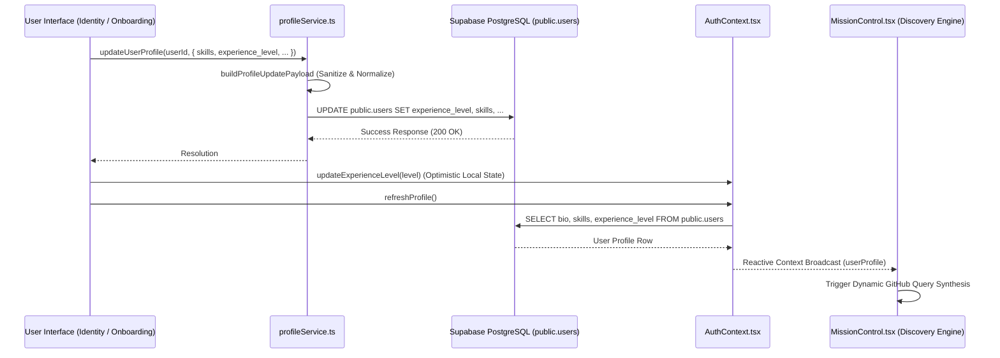

# Profile State Synchronization Architecture

## 1. Overview & Data Flow

Open Source Scout tracks developer profile parameters (GitHub handle, bio, categorized skills, and experience level) to calibrate the automated issue scanner and AI dossier evaluator.



---

## 2. Database Schema Contract

Defined in migration `20260907100000_add_experience_level.sql`:

```sql
ALTER TABLE public.users
ADD COLUMN IF NOT EXISTS experience_level TEXT
CHECK (experience_level IN ('Beginner', 'Intermediate', 'Senior'));
```

### Normalization & Defensive Fallbacks

To ensure total backward compatibility for legacy users with null values:

- Any `NULL`, empty, or unrecognized string is normalized to `'Beginner'` by `normalizeExperienceLevel()`.
- Client context never surfaces an `undefined` or null experience tier.

---

## 3. Type System Integration

```ts
export type ExperienceLevel = 'Beginner' | 'Intermediate' | 'Senior';

export interface UserProfile {
  bio: string;
  skills: string[];
  github_handle: string;
  automation_count_today: number;
  last_automation_date: string;
  custom_comment_enabled: boolean;
  custom_comment_text: string | null;
  experience_level?: ExperienceLevel;
}
```

---

## 4. Performance & Reactivity Guarantees

1. **Optimistic UI Updates**: Updating the experience tier in settings changes the in-memory state instantly, preventing UI stutter.
2. **Context Synchronization**: Calling `refreshProfile()` ensures all cross-cutting tabs (Mission Control, Pipeline, Dossier) re-render with fresh profile data.
3. **Decoupled Architecture**: `profileService.ts` encapsulates pure database operations, keeping presentation components testable and isolated.
