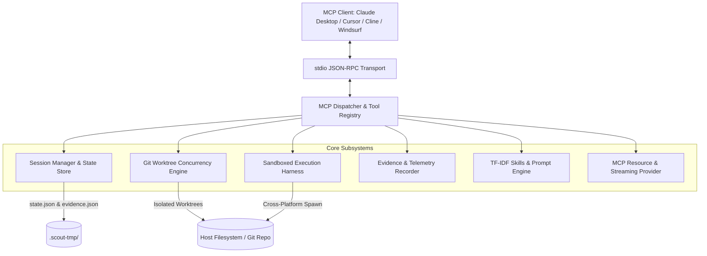
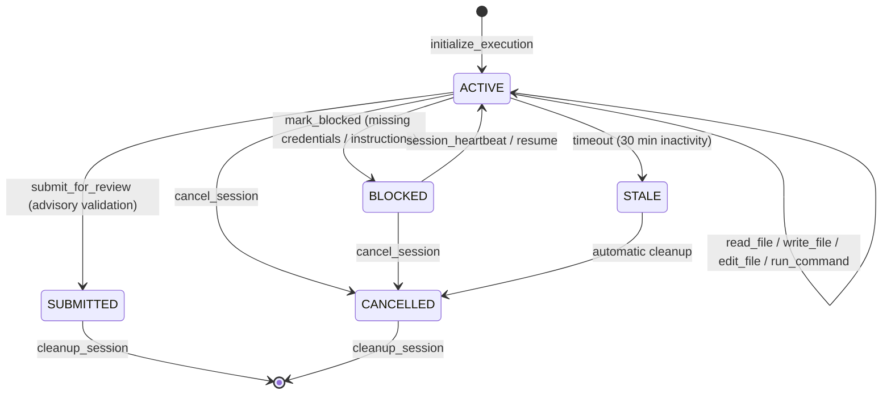

# Scout MCP v2: Complete Architectural Specification

## 1. Executive Summary

**Scout MCP v2** is an enterprise-grade Model Context Protocol (MCP) server designed to orchestrate autonomous coding agents within isolated Git worktrees. Scout MCP bridges frontier reasoning models (e.g. Claude 3.5 Sonnet, GPT-4o, Gemini 1.5 Pro) with local and cloud developer environments, providing guaranteed execution containment, comprehensive telemetry, automated validation, and tamper-resistant audit trails.

---

## 2. System Architecture

The following diagram illustrates the architecture and data flows of Scout MCP v2:

---

## 3. Session Lifecycle State Machine

Each task in Scout MCP executes within a strictly governed finite state machine (FSM):

### State Transitions

- **`ACTIVE`**: The session is bound to an isolated Git worktree branch (`scout/session-<id>`). File modifications and command execution are permitted.
- **`BLOCKED`**: The agent has encountered an unresolvable issue (e.g. absent API keys, conflicting requirements) and records a structured reason.
- **`SUBMITTED`**: All changes are committed, advisory validation test suites are executed, evidence is snapshotted, and a Pull Request URL is recorded.
- **`CANCELLED`**: The session was terminated manually or aborted due to safety constraints.
- **`STALE`**: No heartbeat received within `DEFAULT_STALE_TIMEOUT_MS` (30 minutes).

---

## 4. Git Worktree Concurrency & Rollback Architecture

To allow parallel autonomous execution without branch collisions or dirty index contention:

1. **Per-Session Worktrees**: Every session receives an independent worktree in `.scout-tmp/worktrees/session-<id>` on a dedicated branch `scout/session-<id>`.
2. **Lock Retries with Exponential Backoff**: Git index operations wrap `execWithGitLockRetry` (handling transient `.git/index.lock` contention across concurrent worker threads).
3. **Atomic Rollback on Failure**: If worktree checkout or initialization fails, `rollbackWorktreeCreation` purges the detached directory and deletes the dangling branch, preserving host repository integrity.
4. **LRU Eviction**: Active worktrees are limited to `SCOUT_MAX_WORKTREES` (default: 10), pruning stale worktrees cleanly.

---

## 5. Tool Catalog

Scout MCP exposes 12 specialized tools compliant with the Model Context Protocol:

| Tool                   | Category      | Description                                                                 | Safety Level     |
| ---------------------- | ------------- | --------------------------------------------------------------------------- | ---------------- |
| `initialize_execution` | Lifecycle     | Bootstraps a session, creates isolated Git worktree, registers state        | Write / Mutating |
| `read_file`            | File System   | Reads whole files or chunked byte ranges with UTF-8 boundary safety         | Safe / Read-Only |
| `write_file`           | File System   | Creates or completely overwrites files within worktree bounds               | Mutating         |
| `edit_file`            | File System   | Applies deterministic hunk replacements with multi-chunk rollback           | Mutating         |
| `run_command`          | Execution     | Runs commands with cross-platform shell resolution, timeout, and rss limits | Guarded          |
| `submit_for_review`    | Lifecycle     | Runs advisory validation pipelines and finalizes session                    | Mutating         |
| `cancel_session`       | Lifecycle     | Aborts active session and rolls back uncommitted changes                    | Mutating         |
| `cleanup_session`      | Lifecycle     | Destroys Git worktree and removes session state                             | Destructive      |
| `mark_blocked`         | Collaboration | Marks session as blocked with structured reason and instructions            | Mutating         |
| `session_heartbeat`    | Health        | Refreshes session last active timestamp to prevent stale reap               | Safe             |
| `get_session_info`     | Diagnostics   | Returns active metadata, git diff, and execution evidence                   | Safe / Read-Only |
| `list_worktrees`       | Diagnostics   | Lists all active and inactive Scout worktrees                               | Safe / Read-Only |

---

## 6. MCP Resources & URI Schemes

Scout MCP provides real-time access to live session data via standard MCP resources:

- `scout://sessions/{session_id}/status`: JSON payload containing session status, timestamps, and workspace metadata.
- `scout://sessions/{session_id}/diff`: Real-time untracked + tracked Git diff of the active session.
- `scout://sessions/{session_id}/evidence`: Comprehensive execution history, commands, exit codes, and durations.
- `scout://skills`: Dynamic catalog of discoverable workspace skills and guidelines.

---

## 7. Telemetry & Auditing

- **Timeline Recording**: Every state transition generates an immutable timestamped event (`START`, `EDIT`, `EXEC`, `SUBMIT`, `BLOCK`, `CANCEL`).
- **Resource Profiling**: Captures peak resident memory (`peak_rss_bytes`), execution duration (`total_command_duration_ms`), and process exit codes.
- **Export Bundle**: The `export_session_bundle` feature packs diffs, commands, telemetry, and environment details into an offline audit archive.

---

## 8. Threat Model & Security Boundaries

1. **Path Traversal Defense**: All file paths are strictly resolved against the session worktree root (`toWorkspacePath`). Absolute path escapes or symlink dereferencing outside workspace boundaries are rejected.
2. **Execution Sandboxing**: Commands execute with `SCOUT_MAX_EXEC_TIME_MS` (5 min default) timeouts, `SIGKILL` on tree termination via `tree-kill`, and process-tree resource tracking.
3. **Sensitive Environment Sanitization**: API tokens and private credentials in commands and process output are redacted before persisting into `evidence.json`.
4. **Git Isolation**: The primary repository working copy remains completely clean; changes only take place in detached worktree branches.
