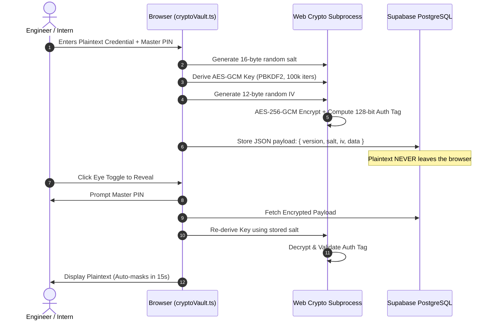

# Zero-Knowledge Cryptographic Vault Architecture

This document specifies the client-side cryptographic guarantees, security parameters, and data lifecycle for Open Source Scout's **Access & Credentials Vault**.

---

## 1. Zero-Knowledge Threat Model

In Open Source Scout's Bring-Your-Own-Backend (BYOB) architecture:

- **Plaintext credentials never cross the network boundary.**
- Passwords, access tokens, and sensitive notes are encrypted strictly in the user's browser before transmission to Supabase.
- Neither the hosted client nor the Supabase database instance has knowledge of or access to the master passphrase.
- If the Supabase database is dumped or intercepted, all credential payloads remain encrypted ciphertext with 128-bit authentication tags.

---

## 2. Cryptographic Specifications

| Parameter                      | Specification                            | Standard / RFC             |
| ------------------------------ | ---------------------------------------- | -------------------------- |
| **Cipher**                     | AES-256-GCM                              | NIST SP 800-38D            |
| **Authentication Tag**         | 128-bit Galois Field MAC                 | RFC 5116                   |
| **Key Derivation**             | PBKDF2 with HMAC-SHA-256                 | RFC 2898                   |
| **PBKDF2 Iterations**          | 100,000 iterations                       | OWASP Recommended Minimum  |
| **Salt**                       | 16 bytes (128 bits) CSPRNG               | `crypto.getRandomValues()` |
| **Initialization Vector (IV)** | 12 bytes (96 bits) CSPRNG per encryption | NIST Recommended Nonce     |
| **Key Length**                 | 256 bits                                 | AES-256                    |

---

## 3. Data Flow & Encryption Lifecycle

---

## 4. In-Memory Security & Clipboard Protection

1. **Transient Memory Lifecycle:**
   - Keys are held as non-extractable `CryptoKey` objects inside the browser's native Web Crypto engine.
   - Raw key material cannot be read by JavaScript `console.log` or third-party extensions.
2. **Auto-Clearing Clipboard Buffer:**
   - `copyToClipboardSecurely(secret, timeoutMs)` copies sensitive passwords to the system clipboard and schedules an automated wipe after 30 seconds.
   - The clipboard buffer is inspected before wiping to prevent overwriting user-copied content if they copied something else in the interim.
3. **Automatic Re-Masking:**
   - When an Eye toggle is clicked (`••••••••` -> plaintext), an automatic 15-second re-mask timer triggers, restoring the bullet mask without requiring user interaction.

---

## 5. References & Implementations

- Implementation: [`apps/web/src/utils/cryptoVault.ts`](../../apps/web/src/utils/cryptoVault.ts)
- Test Suite & Benchmark: [`apps/web/src/utils/cryptoVault.test.ts`](../../apps/web/src/utils/cryptoVault.test.ts)
