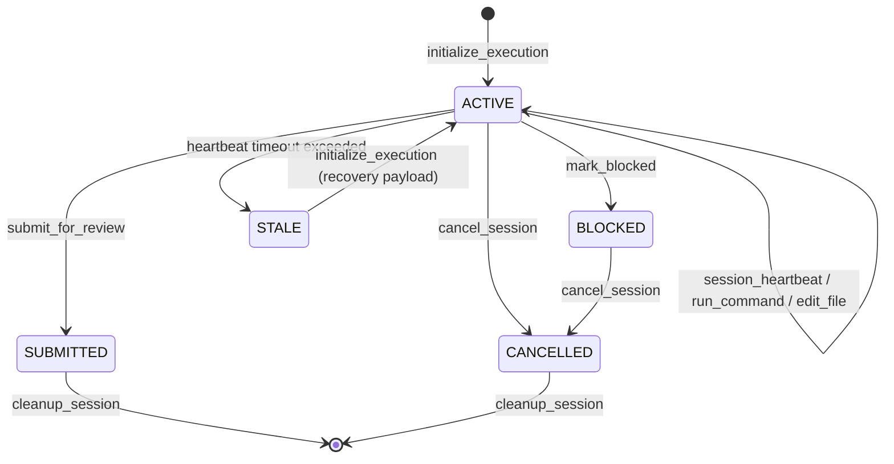

# Scout MCP Session Lifecycle & Local Persistence Specification

## 1. Overview

The Scout Model Context Protocol (MCP) server coordinates autonomous agent execution within local Git worktrees. This specification details the session lifecycle states, state transitions, atomic persistence model, and server reboot hydration guarantees.

---

## 2. Session Lifecycle State Machine



### State Definitions

- **`ACTIVE`**: The session is actively leased by an autonomous agent. Tool execution (`run_command`, `read_file`, `write_file`, `edit_file`) is permitted, and periodic `session_heartbeat` calls refresh the lease timestamp.
- **`SUBMITTED`**: The AI agent concluded its execution and submitted work for external review via `submit_for_review`. Modifications are locked.
- **`BLOCKED`**: The agent encountered an unresolvable obstacle and signaled `mark_blocked` with an explicit reason.
- **`STALE`**: Heartbeat elapsed past timeout threshold (default 5 minutes). The session cannot execute further commands; a new session must be initialized. If a worktree diff is detected, it is preserved in the recovery payload.
- **`CANCELLED`**: Execution was aborted via `cancel_session`. Active processes are terminated with `SIGTERM`/`SIGKILL`.

---

## 3. Local Persistence Model (`state.json`)

Session state is persisted locally at `<workspace>/.scout-tmp/state.json`.

### 3.1 Lockfile Concurrency Protection

To prevent corrupt writes from multiple concurrent CLI or server invocations, writes acquire `<workspace>/.scout-tmp/state.json.lock`:

1. Atomic lock creation using `fs.openSync(lockPath, 'wx')`.
2. Automatic backoff and retries (up to 10 attempts with 20ms–100ms jitter).
3. Stale lock expiration (locks older than 10 seconds are automatically reclaimed).

### 3.2 Atomic Write Protocol

Writes to `state.json` never overwrite in place:

1. State is serialized to a temporary file: `state.json.tmp.<PID>.<timestamp>`.
2. Flushed to disk with `fs.fsyncSync`.
3. Renamed atomically over `state.json` using `fs.renameSync`.
4. Lockfile is deleted.

### 3.3 Debounce Buffer

Frequent state updates (e.g. rapid heartbeats) are debounced with `queueLocalStateFlush` (100ms window) and forced immediately with `flushLocalState()` before process termination or critical transitions.

---

## 4. State JSON Schema

```json
{
  "active_session_id": "123e4567-e89b-12d3-a456-426614174000",
  "sessions": {
    "123e4567-e89b-12d3-a456-426614174000": {
      "session_id": "123e4567-e89b-12d3-a456-426614174000",
      "status": "ACTIVE",
      "workspace_path": "/path/to/worktree",
      "commit_hash": "a1b2c3d4e5f67890123456789abcdef012345678",
      "created_at": "2026-10-26T10:00:00.000Z",
      "client_id": "vscode-extension",
      "last_heartbeat_at": "2026-10-26T10:04:30.000Z",
      "blocked_reason": null,
      "pr_url": null,
      "evidence_count": 3
    }
  }
}
```

---

## 5. Server Reboot & Workspace Hydration

When the Scout MCP server crashes or restarts:

1. `hydrateSessionWorkspaces(cwd)` inspects `.scout-tmp/state.json`.
2. Validates all sessions where `status === 'ACTIVE'`.
3. Re-populates the in-memory `sessionWorkspaces` map.
4. Allows connected MCP clients to resume tool calls immediately without needing re-initialization.
5. On `cleanup_session` or `cancel_session`, the session mapping is evicted from memory and local worktrees are cleanly unlinked.
