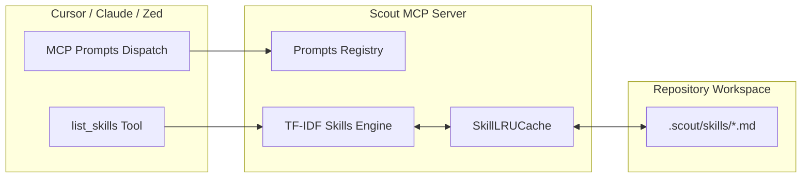

# Scout MCP Skills & Prompts Specification Guide

## 1. Overview

Scout MCP equips autonomous AI coding agents with contextual intelligence through two complementary capabilities:

1. **Dynamic Skills Engine**: Discovers, caches, and ranks repository-specific development conventions and technical guidelines from `.scout/skills/` using TF-IDF and metadata affinity scoring.
2. **MCP Prompts Library**: Provides standardized workflow templates (`scout_architect_mode`, `scout_debug_issue`, `scout_prepare_pr`) directly callable by AI coding environments such as Cursor, Claude Desktop, and Zed.



---

## 2. Skill Authoring Specification

Skills are Markdown files located inside the `.scout/skills/` directory of the project root. If `.scout/skills/` is missing, Scout MCP automatically bootstraps default engineering skills into the workspace on first run.

### 2.1 YAML Frontmatter Schema

Each skill file must begin with a YAML frontmatter block enclosed within triple dashes (`---`).

| Field         | Type               | Required | Description                                                                        | Example                                                   |
| :------------ | :----------------- | :------- | :--------------------------------------------------------------------------------- | :-------------------------------------------------------- |
| `name`        | string             | **Yes**  | Unique identifier for the skill (alphanumeric, hyphens).                           | `react-performance`                                       |
| `description` | string             | **Yes**  | Summary of the guidelines provided by this skill. Used heavily in TF-IDF scoring.  | `React component rendering optimization and memoization.` |
| `trigger`     | string             | No       | Activation strategy: `ALWAYS`, `CONDITIONAL` (default), or `MANUAL`.               | `CONDITIONAL`                                             |
| `languages`   | string[] \| string | No       | Programming languages this skill applies to (e.g. `typescript`, `python`, `rust`). | `['typescript', 'react']`                                 |
| `tags`        | string[] \| string | No       | Categorical classification tags (e.g. `frontend`, `security`, `performance`).      | `['frontend', 'ui']`                                      |

### 2.2 Activation Trigger Semantics

- **`ALWAYS`**: Unconditionally injected and prioritized at the top of ranking lists regardless of prompt tokens (e.g. core project architectural invariants, security boundary rules).
- **`CONDITIONAL`**: Automatically activated and ranked when relevance score exceeds baseline threshold based on prompt tokens, language affinity, and matching tags.
- **`MANUAL`**: Dormant unless specifically requested by name or explicit filter query.

### 2.3 Example Skill Template

```markdown
---
name: async-tokio-best-practices
description: Concurrency primitives, channel management, and thread pool guidelines for Tokio async services.
trigger: CONDITIONAL
languages:
  - rust
tags:
  - backend
  - systems
  - concurrency
---

# Tokio Concurrency Guidelines

1. **Avoid Blocking Operations in Async Contexts**:
   - Never call blocking syscalls (`std::fs`, `std::thread::sleep`) inside an async runtime worker thread.
   - Offload blocking CPU or file operations to `tokio::task::spawn_blocking`.

2. **Graceful Cancellation**:
   - Utilize `tokio::select!` with `tokio_util::sync::CancellationToken` for robust lifecycle management.
```

---

## 3. Dynamic Skills Discovery & Ranking

### 3.1 LRU File Caching & Invalidation

To maintain zero-latency MCP responsiveness without re-parsing YAML frontmatter on every invocation, Scout MCP maintains an in-memory `SkillLRUCache` (capacity 256 entries).

- **Fast mtime Check**: Cache keys consist of the absolute file path and file modification time (`mtimeMs`).
- **Resilient Recovery**: Malformed YAML frontmatter or unclosed syntax does not crash the server; warnings are recorded and corrupted files are safely skipped.

### 3.2 TF-IDF Relevance Algorithm

Scout MCP ranks skills using sublinear TF-IDF relevance scoring combined with field weighting and stopword elimination:

$$\text{Score} = \text{Language Affinity} + \text{Tag Affinity} + \sum_{t \in Q} (1 + \ln \text{TF}(t)) \cdot \left(1 + \ln \frac{N}{\text{DF}(t)}\right)$$

- **Field Weights**: Name matches receive 5x weighting; tag and language matches receive 4x weighting; description matches receive 2x weighting.
- **Language Affinity**: Matching the repository or task target language grants a +20 bonus; skills restricted to unrelated languages receive a -10 penalty.
- **Tag Affinity**: Matching explicit filter tags grants a +15 bonus.

---

## 4. `list_skills` MCP Tool Reference

Agents can browse, search, and rank available project skills using the `list_skills` tool.

### 4.1 Tool Schema

```json
{
  "name": "list_skills",
  "description": "Query and browse available development skills, guidelines, and project conventions.",
  "parameters": {
    "type": "object",
    "properties": {
      "task_description": {
        "type": "string",
        "description": "Optional task prompt to rank skills by TF-IDF relevance."
      },
      "cwd": {
        "type": "string",
        "description": "Optional repository working directory."
      },
      "languages": {
        "type": "array",
        "items": { "type": "string" },
        "description": "Optional target programming languages to filter guidelines."
      },
      "tags": {
        "type": "array",
        "items": { "type": "string" },
        "description": "Optional skill tags to filter guidelines."
      }
    }
  }
}
```

### 4.2 Example Invocation

```json
{
  "name": "list_skills",
  "arguments": {
    "task_description": "Implement thread-safe async queue worker in Rust",
    "languages": ["rust"],
    "tags": ["backend"]
  }
}
```

### 4.3 Example Output

```json
{
  "count": 1,
  "skills": [
    {
      "name": "async-tokio-best-practices",
      "filename": "async-tokio-best-practices.md",
      "description": "Concurrency primitives, channel management, and thread pool guidelines for Tokio async services.",
      "trigger": "CONDITIONAL",
      "tags": ["backend", "systems", "concurrency"],
      "languages": ["rust"]
    }
  ]
}
```

---

## 5. MCP Prompts Capability Reference

Scout MCP registers three standard workflow prompts conforming to the Model Context Protocol prompts specification.

### 5.1 `scout_architect_mode`

Transforms high-level feature requirements into a comprehensive technical architectural blueprint with dependency breakdown and rollback strategy.

- **Arguments**:
  - `feature_request` (_required_): High-level feature request or engineering goal.
  - `target_ecosystem` (_optional_): Target tech stack (e.g. Node.js, Rust, Go).

**Workflow Output**:

1. Architectural Blueprint & Component Decomposition.
2. File Mutation & Migration Strategy.
3. Guardrails & Risk Assessment.
4. Step-by-Step Phased Implementation Plan.

### 5.2 `scout_debug_issue`

Guides systematic root-cause analysis for bugs, test failures, or performance regressions.

- **Arguments**:
  - `issue_description` (_required_): Description of the defect, reproduction steps, or error log.
  - `error_log` (_optional_): Exact stack trace or test failure output.

**Workflow Output**:

1. Anomaly Characterization & Reproduction Hypothesis.
2. Code Trace & Failure Locus Identification.
3. Minimal Surgical Fix Specification.
4. Regression Test Matrix.

### 5.3 `scout_prepare_pr`

Synthesizes session changes, git diffs, and validation telemetry into a comprehensive, human-reviewable pull request description.

- **Arguments**:
  - `session_id` (_required_): The active Scout session UUID.
  - `target_branch` (_optional_, default: `main`): Target branch for merge.

**Workflow Output**:

1. Executive Summary & Problem Solved.
2. Structured List of Changes per Subsystem.
3. Automated Validation Results & Evidence Verification.
4. Co-Author & Contributor Attribution Trailers.

---

## 6. Host Integration Guide

### 6.1 Cursor Setup

Add Scout MCP into `.cursor/mcp.json` or your global Cursor MCP configuration:

```json
{
  "mcpServers": {
    "scout": {
      "command": "node",
      "args": ["/path/to/packages/scout-mcp/dist/index.js"],
      "env": {
        "NODE_ENV": "production"
      }
    }
  }
}
```

In Cursor Chat, type `/` to access registered MCP Prompts (`/scout_architect_mode`, `/scout_debug_issue`, `/scout_prepare_pr`).

### 6.2 Claude Desktop Setup

Configure `claude_desktop_config.json`:

```json
{
  "mcpServers": {
    "scout": {
      "command": "node",
      "args": ["/path/to/packages/scout-mcp/dist/index.js"]
    }
  }
}
```

In Claude Desktop, click the **Attach Prompt** icon or use Slash Commands to invoke Scout prompts with parameter dialogs.
