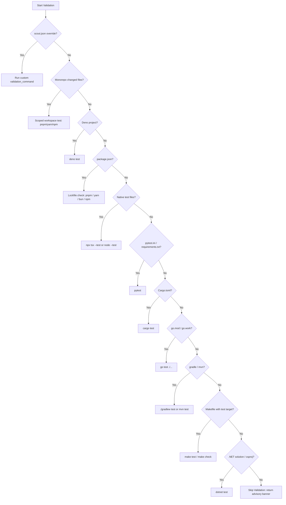

# Scout MCP Validation Engine: Multi-Ecosystem Testing & Verification Guide

## 1. Overview

The advisory validation runner in Scout MCP automatically discovers, configures, and executes unit and integration test suites before an agent submits its changes for human review (`submit_for_review`).

Validation results are captured directly into the structured session evidence payload, allowing human code reviewers to immediately inspect whether all tests pass without manual verification.

---

## 2. Multi-Ecosystem Support Matrix

Scout MCP features native, zero-config detection across 8 major programming language ecosystems:

| Ecosystem                  | Config File / Trigger                                  | Default Validation Command               |
| :------------------------- | :----------------------------------------------------- | :--------------------------------------- |
| **Maintainer Override**    | `scout.json` / `.scout.json` / `.scout/config.json`    | Custom `validation_command`              |
| **Deno**                   | `deno.json` or `deno.jsonc`                            | `deno test`                              |
| **Node.js (pnpm)**         | `package.json` + `pnpm-lock.yaml`                      | `pnpm run scout:validate` or `pnpm test` |
| **Node.js (Yarn)**         | `package.json` + `yarn.lock`                           | `yarn scout:validate` or `yarn test`     |
| **Node.js (Bun)**          | `package.json` + `bun.lockb` or `bun.lock`             | `bun run scout:validate` or `bun test`   |
| **Node.js (npm)**          | `package.json` + `package-lock.json` (or default)      | `npm run scout:validate` or `npm test`   |
| **Native Node / tsx**      | `test/`, `tests/`, `src/` (`*.test.ts`, `*.test.js`)   | `npx tsx --test` or `node --test`        |
| **Python**                 | `pytest.ini` or `requirements.txt` containing pytest   | `pytest`                                 |
| **Rust**                   | `Cargo.toml`                                           | `cargo test`                             |
| **Go**                     | `go.mod` or `go.work`                                  | `go test ./...`                          |
| **Java / Kotlin (Gradle)** | `gradlew` wrapper, `build.gradle`, `build.gradle.kts`  | `./gradlew test` or `gradle test`        |
| **Java (Maven)**           | `mvnw` wrapper or `pom.xml`                            | `./mvnw test` or `mvn test`              |
| **.NET (C# / F#)**         | `*.sln`, `*.csproj`, or `*.fsproj`                     | `dotnet test`                            |
| **Make**                   | `Makefile`, `makefile`, `GNUmakefile` (`test:` target) | `make test` or `make check`              |

---

## 3. Resolution Precedence Order

When evaluating which validation command to execute, Scout MCP resolves candidate commands in strict order:



---

## 4. Custom Maintainer Overrides (`scout.json`)

Repository maintainers can explicitly define the exact test pipeline by placing a `scout.json` in their repository root:

```json
{
  "validation_command": "./scripts/run-ci-checks.sh --coverage"
}
```

### Supported Locations

1. `scout.json` (recommended)
2. `.scout.json` (hidden configuration)
3. `.scout/config.json` (sub-directory configuration)

When `validation_command` is present, it **takes highest priority**, bypassing all heuristics.

---

## 5. Monorepo Workspace Package Scoping

In large monorepos containing multiple packages (e.g., `packages/*`, `apps/*`, `libs/*`), running the full test suite can take dozens of minutes.

Scout MCP detects workspace roots:

- `pnpm-workspace.yaml` (pnpm monorepos)
- `package.json` `"workspaces"` field (npm / yarn monorepos)

When changes are localized to a specific package directory (e.g., `packages/auth/src/jwt.ts`), Scout automatically targets only the affected package:

- **pnpm:** `pnpm --filter @org/auth test`
- **yarn:** `yarn workspace @org/auth test`
- **npm:** `npm test --workspace=@org/auth`

---

## 6. Output Buffer Capping & Memory Protection

Test suites often generate massive volumes of console logs. To prevent JSON-RPC transport serialization failures and memory exhaustion:

1. Maximum captured output per stream (`stdout`, `stderr`) is capped at **64 KB**.
2. If output exceeds 64 KB, Scout MCP preserves:
   - The **first 16 KB** (initial configuration and test startup)
   - A **truncation notice** highlighting how many bytes were omitted
   - The **last 48 KB** (the final test summary, error stack traces, and failure diagnostics)

Example truncation notice:

```text
... [TRUNCATED: Output exceeded 64KB limit; omitted 451829 bytes] ...
```

---

## 7. Structured Test Summary Parsing

In addition to raw standard output and standard error, Scout MCP extracts a structured `validation_summary` object from test logs:

```json
{
  "validation_ran": true,
  "validation_passed": true,
  "exit_code": 0,
  "validation_summary": {
    "total": 42,
    "passed": 40,
    "failed": 2,
    "duration_ms": 2850
  }
}
```

This structured summary supports:

- **Node.js native test runner & tsx:** `ℹ tests N`, `ℹ pass N`, `ℹ fail N`, `ℹ duration_ms N`
- **Jest & Vitest:** `Tests: X passed, Y failed, Z total`, `Time: X.XX s`
- **Pytest:** `X passed, Y failed in Z.ZZs`
- **Cargo:** `test result: ok. X passed; Y failed; finished in Z.ZZs`
